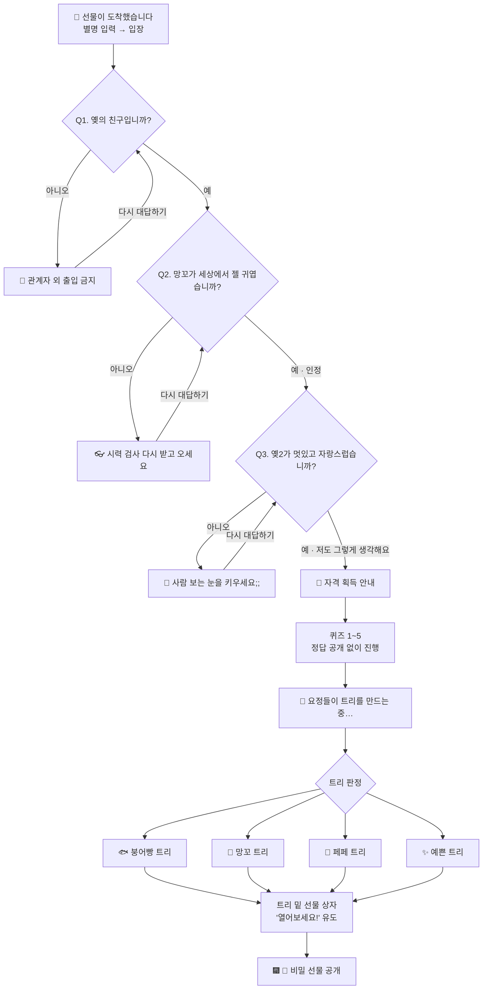

# 🎁 옞의 크리스마스 선물 — 서비스 스펙

친구에게 링크 하나만 보내면 끝나는 **장난 + 퀴즈형 크리스마스 트리 사이트**.
동화책을 한 장씩 넘기는 느낌으로 질문에 답하고, 마지막 퀴즈 결과에 따라 **서로 다른 트리**를 받고,
트리 밑 선물 상자를 열면 🤫 **비밀 선물**이 공개된다. (내용은 직접 열어보기 전까지 비밀)

---

## 1. 한눈에 보는 흐름



---

## 2. 화면별 상세

| # | 화면 | 내용 | 버튼 / 동작 |
|---|------|------|-------------|
| 0 | **도착** | "🎁 크리스마스 선물이 도착했습니다!" + 흔들리는 선물 상자 | 별명 입력(1~10자, 공백만 입력 불가) → `입장하기` |
| 1 | **Q1 출입 심사** | 옞의 친구입니까? | `예` → 다음 / `아니오` → 거절 화면 |
| 1-N | 거절 | 🚫 **관계자 외 출입 금지입니다** | `다시 대답하기` → Q1 |
| 2 | **Q2 출입 심사** | 망꼬가 세상에서 젤 귀엽습니까? (망꼬 픽셀 얼굴 표시) | `예` → "인정 👍" 잠깐 표시 후 다음 |
| 2-N | 거절 | 👓 **시력 검사 다시 받고 오세요** (시력표 그림) | `다시 대답하기` → Q2 |
| 3 | **Q3 출입 심사** | 옞2가 평소에 멋있고, 자랑스럽다고 생각합니까? | `예` → "저도 그렇게 생각해요 🥹" 잠깐 표시 후 다음 |
| 3-N | 거절 | 🦶 **사람 보는 눈을 키우세요;;** (별명이 걷어차여 날아가는 애니메이션) | `다시 대답하기` → Q3 |
| 4 | **자격 획득** | 다듬은 안내 멘트 (아래 4장) | `시험 시작하기` |
| 5~9 | **퀴즈** | 3지선다(마지막은 2지선다). 정답 여부는 **공개하지 않음** → 결과 트리에서 한 번에 공개 | 보기 클릭 → 다음 문제 |
| 10 | **제작 중** | "요정들이 트리를 만드는 중…" 로딩 (약 2.5초) | 자동 이동 |
| 11 | **트리 공개** | 판정된 트리 + 한 줄 코멘트 + 트리 밑 선물 상자 (통통 튀며 "열어보세요!") | 선물 상자 클릭 |
| 12 | **선물 공개** | 상자 뚜껑 날아감 → 🎆 → 🤫 비밀 (직접 열어보세요) | `처음부터 다시`, `링크 복사하기` |

---

## 3. 퀴즈 & 정답

| 키 | 질문 | 보기 | 정답 |
|----|------|------|------|
| `yeajBirthday` | 옞의 생일은? | 9월 11일 / 11월 9일 / 9월 13일 | **9월 11일** |
| `yeajAnime` | 옞의 최애 애니는? | 헌터x헌터 / 마마마 / 슈타게 | **슈타게** |
| `mangkkoBirthday` | 망꼬의 생일은? | 6월 13일 / 10월 4일 / 9월 13일 | **6월 13일** |
| `mangkkoArrival` | 망꼬가 우리집에 온 날은? | 6월 13일 / 10월 4일 / 9월 13일 | **10월 4일** |
| `bungeoppang` | {별명}(이)는 슈붕파? 팥붕파? | 슈붕 / 팥붕 | **슈붕** |

- `{별명}(이)는`은 받침에 따라 자동 처리: `민수는`, `지민이는` (영문·숫자는 `는`).
- 질문·정답은 모두 `site/js/config.js` 한 곳에 있으므로 거기만 고치면 된다.

---

## 4. 자격 획득 멘트 (다듬은 버전)

> 📜 **모든 서약이 확인되었습니다.**
>
> {별명}님은 올해 **옞의 크리스마스 선물**을 받을 자격을 얻으셨어요.
>
> 하지만 잠깐! 산타의 요정들이 트리를 만들기 전에 마지막 시험이 남아 있어요.
> 지금부터 고르는 답이 **그대로 트리의 재료**가 됩니다.
>
> 많이 맞히면 반짝반짝 예쁜 트리를, 틀리면… 음, 그건 직접 확인하세요. 🎄

---

## 5. 트리 판정 규칙

위에서부터 **먼저 걸리는 규칙**이 적용된다.

| 우선순위 | 조건 | 결과 트리 | 코멘트 |
|---|------|-----------|--------|
| 1 | 마지막 질문에서 **팥붕** 선택 (앞 답과 무관) | 🐟 **붕어빵 트리**: 초록 트리에 붕어빵 장식, 꼭대기에 "팥" 별, 옆에 김 나는 붕어빵 봉투 | "팥붕파에게는 붕어빵 트리를 드립니다. 슈붕의 세계로 오세요." |
| 2 | 망꼬 생일(Q8) 또는 망꼬 온 날(Q9) 중 **하나라도 틀림** | 🐶 **망꼬 트리**: 망꼬 픽셀 얼굴 + 금색 종을 번갈아 달고, 꼭대기는 웃는 망꼬, 밑에 뼈다귀 | "망꼬를 모르다니… 망꼬로 뒤덮인 트리 보면서 외우세요." |
| 3 | 옞 생일(Q6) 또는 최애 애니(Q7) 중 **하나라도 틀림** | 🐸 **페페 트리**: 우는 페페 트리 이미지 | "옞을 이렇게 모르다니… 트리도 울고 있어요." |
| 4 | 전부 정답 | ✨ **예쁜 트리**: 반짝이는 전구 + 금빛 별, 주변에 산타모자 곰돌이·지팡이 사탕·선물 더미·눈사람 | "완벽해요! 당신은 진정한 옞의 친구 ✨" |

```js
// js/app.js  judgeTree()
if (answers.bungeoppang !== '슈붕')                       return 'bungeoppang';
if (!correct('mangkkoBirthday') || !correct('mangkkoArrival')) return 'mangkko';
if (!correct('yeajBirthday')    || !correct('yeajAnime'))      return 'pepe';
return 'pretty';
```

트리 화면에는 **몇 문제 맞혔는지(예: 3/5)** 도 같이 보여준다.

---

## 6. 기술 구성

- **정적 사이트**(HTML + CSS + 바닐라 JS). 빌드·서버·DB 없음 → 아무 정적 호스팅에 올리면 끝.
- 상태는 메모리에만 있다. 새로고침하면 처음부터 다시 시작한다(장난용이라 의도된 동작).
- 외부 리소스는 Google Fonts(손글씨 폰트 `Gaegu`, `Jua`)만 쓴다.

```
christmas-gift/
├─ site/                  # 🌐 배포되는 사이트 — 이 폴더만 업로드한다
│  ├─ index.html          # 화면 껍데기 (#stage 한 곳에 화면을 갈아 끼움)
│  ├─ css/style.css       # 동화책 스타일, 애니메이션
│  ├─ js/config.js        # ✏️ 질문·정답·멘트·이미지 경로 (여기만 고치면 됨)
│  ├─ js/mangkko.js       # 망꼬 픽셀 아트 (망꼬랜드 art/mangkko-sprite.html 데이터 이식)
│  ├─ js/trees.js         # 트리 4종 렌더링 (SVG / 이미지)
│  ├─ js/effects.js       # 눈 내리기, 폭죽
│  ├─ js/app.js           # 화면 전환·상태·판정 로직
│  └─ assets/             # 이미지
├─ docs/SPEC.md           # 🤫 이 문서 (배포하지 않음)
└─ README.md
```

`site/` 밖의 파일은 사이트 주소로 접근할 수 없으므로, 비밀 문서·메모는 전부 `site/` 바깥에 둔다.

### 화면 전환 방식
- `app.js`의 `screens` 객체에 화면 함수가 있고, `go(name)`이 `#stage`를 비운 뒤 새 화면을 그린다.
- 전환할 때 책장 넘기는 애니메이션(`page-in` 클래스)이 붙는다.

### 이미지 바꾸기
- **비밀 선물 이미지**: 🤫 `config.js`의 `winkImage` 참고 (여기엔 적지 않음).
- **페페 트리**: `site/assets/pepe-tree.webp`.

---

## 7. 실행 & 배포

로컬 실행:
```bash
npx serve site
```
(또는 `site/index.html`을 브라우저로 바로 열어도 된다.)

배포는 **Netlify Drop**을 쓴다.

배포 주소: **https://yeaji-christmas.netlify.app/**

카카오톡 미리보기: `site/index.html`의 `og:*` 태그 + 썸네일 `site/assets/og.png`(1200x630 픽셀아트, 트리·망꼬·선물).
주소가 바뀌면 `og:url`, `og:image`의 절대 URL도 같이 바꾼다.
카톡이 예전 미리보기를 계속 보여주면 https://developers.kakao.com/tool/clear/og 에서 주소를 넣고 캐시를 지운다.

